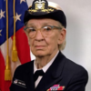
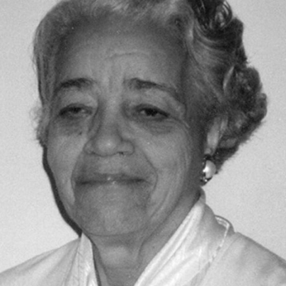
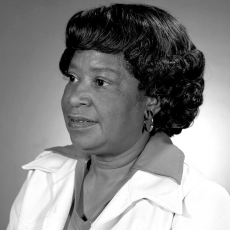
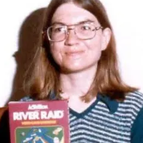

# 👩🏽‍💻 Mulheres Inspiradoras na Tecnologia

### Histórias, comunidades e recursos para fortalecer mulheres em tech.

  
  
  

**[Pioneiras](#-mulheres-pioneiras) · [Comunidades](#-comunidades-e-iniciativas) · [YouTube](#-canais-no-youtube) · [Contribuir](#-como-contribuir)**

---

## ✨ Sobre o projeto

A tecnologia também é construída por histórias que merecem ser lembradas.

Este repositório reúne **mulheres que marcaram a história da tecnologia**, além de comunidades, iniciativas e canais que ajudam outras mulheres a **aprender, se conectar e desenvolver suas carreiras na área**.

A proposta é manter uma curadoria simples, útil e colaborativa sobre **mulheres em tecnologia, diversidade e desenvolvimento profissional**.

> [!NOTE]
> A coleção não pretende ser exaustiva. Ela pode crescer com novas referências, comunidades e recursos sugeridos pela própria comunidade.

---

## 👩🏽‍🔬 Mulheres pioneiras

<table align="center">
  <tr>
    <td align="center">
      <a href="https://pt.wikipedia.org/wiki/Ada_Lovelace">
         
        <strong>Ada Lovelace</strong>
      </a>
    </td>
    <td align="center">
      <a href="https://pt.wikipedia.org/wiki/Edith_Clarke">
         
        <strong>Edith Clarke</strong>
      </a>
    </td>
    <td align="center">
      <a href="https://pt.wikipedia.org/wiki/Grace_Hopper">
         
        <strong>Grace Hopper</strong>
      </a>
    </td>
    <td align="center">
      <a href="https://pt.wikipedia.org/wiki/Dorothy_Vaughan">
         
        <strong>Dorothy Vaughan</strong>
      </a>
    </td>
    <td align="center">
      <a href="https://pt.wikipedia.org/wiki/Mary_Kenneth_Keller">
         
        <strong>Mary Kenneth Keller</strong>
      </a>
    </td>
  </tr>
  <tr>
    <td align="center">
      <a href="https://pt.wikipedia.org/wiki/Hedy_Lamarr">
         
        <strong>Hedy Lamarr</strong>
      </a>
    </td>
    <td align="center">
      <a href="https://pt.wikipedia.org/wiki/Joan_Clarke">
         
        <strong>Joan Clarke</strong>
      </a>
    </td>
    <td align="center">
      <a href="https://pt.wikipedia.org/wiki/Katherine_Johnson">
         
        <strong>Katherine Johnson</strong>
      </a>
    </td>
    <td align="center">
      <a href="https://pt.wikipedia.org/wiki/Mary_Jackson">
         
        <strong>Mary Jackson</strong>
      </a>
    </td>
    <td align="center">
      <a href="https://pt.wikipedia.org/wiki/Karen_Sp%C3%A4rck_Jones">
         
        <strong>Karen Spärck Jones</strong>
      </a>
    </td>
  </tr>
  <tr>
    <td align="center">
      <a href="https://pt.wikipedia.org/wiki/Margaret_Hamilton_(cientista_da_computa%C3%A7%C3%A3o)">
         
        <strong>Margaret Hamilton</strong>
      </a>
    </td>
    <td align="center">
      <a href="https://pt.wikipedia.org/wiki/Radia_Perlman">
         
        <strong>Radia Perlman</strong>
      </a>
    </td>
    <td align="center">
      <a href="https://pt.wikipedia.org/wiki/Susan_Kare">
         
        <strong>Susan Kare</strong>
      </a>
    </td>
    <td align="center">
      <a href="https://pt.wikipedia.org/wiki/Carol_Shaw">
         
        <strong>Carol Shaw</strong>
      </a>
    </td>
  </tr>
</table>

Clique no nome de cada pioneira para conhecer um pouco mais sobre sua trajetória.

---

## 🤝 Comunidades e iniciativas

A lista abaixo reúne comunidades e projetos com foco em **tecnologia, carreira, diversidade, formação e redes de apoio**.

<strong>✨ Ver 38 comunidades e iniciativas</strong>

 

- [AI Girls](https://aigirlsbr.github.io/) — protagonismo feminino em inteligência artificial e ciência de dados.
- [Anitas](https://www.linkedin.com/company/anitas) — empoderamento feminino em tecnologia e empreendedorismo.
- [Brazilians in Tech](https://braziliansintech.com/) — conexão e apoio a mulheres brasileiras que estudam ou atuam em tecnologia.
- [Cloud Girls](https://www.cloudgirls.com.br/) — presença e desenvolvimento de mulheres em tecnologia em nuvem.
- [Coletivo Unicas](https://coletivo-unicas.vercel.app/) — incentivo à entrada de garotas e mulheres na área.
- [Comunidade Ballerini](https://www.linkedin.com/company/comunidadeballerini/) — aprendizado, conexão e troca entre pessoas desenvolvedoras.
- [Comunidade Cafeína](https://github.com/ComunidadeCafeina) — acolhimento de pessoas iniciantes em TI, com atenção a grupos minoritários.
- [Data Girls](https://linktr.ee/DataGirls) — desenvolvimento de mulheres em Data Science e Inteligência Artificial.
- [Elas por elas](https://linktr.ee/elaspor) — equidade de gênero e conexão entre mulheres.
- [Elas Programam](https://www.elasprogramam.com.br/) — inspiração, capacitação e oportunidades para ampliar a participação feminina em tecnologia.
- [Feministech](https://feministech.com.br/) — comunidade feminista formada por pessoas trans, não-binárias e mulheres cis que produzem e compartilham conteúdo sobre tecnologia.
- [Girls Support Girls Community](https://linktr.ee/gsgcommunity) — apoio e desenvolvimento de mulheres em áreas de tecnologia.
- [GRACE](http://grace.icmc.usp.br/) — atividades de extensão em tecnologia voltadas ao público feminino.
- [He4rt Developers](https://heartdevs.com/) — comunidade de aprendizado e desenvolvimento acessível em tecnologia.
- [Laboratória](https://linktr.ee/laboratoria_br) — formação, mentorias e apoio à inserção de mulheres no mercado de trabalho.
- [Manas Digitais](https://linktr.ee/manasdigitais) — promoção de mulheres em carreiras de TI na região Amazônica.
- [MariaLab](https://www.marialab.org/) — comunidade feminista com atuação em tecnologia e pensamento interseccional.
- [Meninas Digitais](https://linktr.ee/meninasdigitaissbc) — incentivo ao interesse de meninas por carreiras em Tecnologia da Informação e Comunicação.
- [Minas Programam](https://linktr.ee/minasprogramam) — enfrentamento de estereótipos de gênero e raça em ciência, tecnologia e computação.
- [Mulheres Agilistas](https://linktr.ee/MulheresAgilistas) — comunidade de mulheres ligadas à agilidade.
- [Mulheres de Produto](https://mulheresdeproduto.com/) — desenvolvimento e capacitação profissional em produto, tecnologia, engenharia e design.
- [PretaLab](https://linktr.ee/pretalab) — conexão e fortalecimento de mulheres negras na tecnologia.
- [PrograMaria](https://vamosjuntes.programaria.org/links) — empoderamento de meninas e mulheres por meio da tecnologia.
- [PyLadies](https://linktr.ee/pyladiesbrasil) — incentivo à participação de mulheres na comunidade Python.
- [QA Ladies](https://linktr.ee/qaladies) — compartilhamento de conhecimento em QA, Dev e Ops.
- [Reprograma](https://linktr.ee/ReprogramaBr) — formação e inclusão de mulheres no setor de tecnologia.
- [R-Ladies Belo Horizonte](https://linktr.ee/rladiesbh) — promoção da diversidade de gênero na comunidade da linguagem R.
- [Se Candidate, Mulher](https://ig.rdstation.com/secandidatemulher) — iniciativa de impacto social voltada à inserção de mulheres no mercado de trabalho.
- [She’s Tech](https://linktr.ee/shestech) — fortalecimento da presença feminina em tecnologia por meio de inspiração, engajamento e capacitação.
- [Start Coding](https://linktr.ee/startcoding) — iniciativa voltada à entrada de mulheres no setor de tecnologia.
- [STEM para as Minas](https://www.stemparaminas.com/) — divulgação de oportunidades em matemática, engenharia, tecnologia e ciências para meninas e mulheres.
- [SysAdminas](https://linktr.ee/sysadminas) — rede de apoio e orientação para mulheres interessadas em infraestrutura de TI.
- [Test Girls](https://testgirls.com.br/) — espaço de aprendizado, crescimento, carreira, tecnologia e qualidade.
- [UX para Minas Pretas](https://linktr.ee/uxmpretas) — capacitação e conexão de mulheres negras para o mercado de tecnologia e UX.
- [WoMakersCode](https://linktr.ee/womakerscode) — desenvolvimento profissional e econômico de mulheres em tecnologia.
- [Women Game Jam Brazil](http://www.womengamejam.org/pt/) — maratona não competitiva de desenvolvimento de jogos voltada a mulheres cis, trans e pessoas não-binárias.
- [Women Techmakers](https://developers.google.com/womentechmakers) — iniciativa do Google que oferece visibilidade, comunidade e recursos para mulheres em tecnologia.
- [Women that React](https://linktr.ee/womenthatreact) — comunidade para mulheres que desenvolvem ou têm curiosidade sobre React e React Native.

---

## 📺 Canais no YouTube

Uma seleção de canais com conteúdos sobre **programação, tecnologia, dados, carreira e experiências profissionais**.

<strong>▶️ Ver 18 canais</strong>

 

- [Ana Beatriz Neri](https://www.youtube.com/@AnaBeatrizNeriDev/) — aulas e estudos sobre Java.
- [Attekita Dev](https://www.youtube.com/@attekitadev) — programação, carreira internacional e trajetória profissional.
- [Cami Massaneiro](https://www.youtube.com/@camimassaneiro1944) — inovação, tecnologia, programação, eventos e empreendedorismo.
- [Code By Duda](https://www.youtube.com/@CodeByDuda) — tecnologia, Engenharia de Software e mercado de trabalho.
- [Glaucia Lemos](https://www.youtube.com/@GlauciaLemos) — programação em diferentes tecnologias e linguagens open source.
- [JuliaLabs](https://www.youtube.com/@Julia_Labs) — projetos práticos de tecnologia.
- [Kamila code](https://www.youtube.com/@Kamilacode) — Java, Spring, backend, cloud e carreira.
- [Karine Lago](https://www.youtube.com/@KarineLago) — análise de dados com Microsoft Excel e Power BI.
- [lelemaine channel](https://www.youtube.com/@lelemainechannel) — conhecimentos e experiências em TI de forma descontraída.
- [Loiane Groner](https://www.youtube.com/@loianegroner) — Angular, Java, Spring Framework, VS Code e cloud.
- [Michelli Brito](https://www.youtube.com/@MichelliBrito) — programação, arquitetura de software e carreira em TI.
- [Peixe Babel](https://www.youtube.com/@PeixeBabel) — programação e conhecimentos gerais em tecnologia.
- [Programação Dinâmica](https://www.youtube.com/@pgdinamica) — programação, ciência de dados, machine learning e inteligência artificial.
- [quero ser dev](https://www.youtube.com/@queroserdev) — inclusão em tecnologia, desenvolvimento Web, Git, GitHub, React e carreira.
- [Rafaella Ballerini](https://www.youtube.com/@rafaellaballerini) — experiências no mundo tech e carreira.
- [Stephanie Cardoso](https://www.youtube.com/@dev_stephanie) — rotina em desenvolvimento backend e dicas para entrar na área.
- [Trans de Programa](https://www.youtube.com/@TransdePrograma) — tecnologia, Angular, Firebase e reflexões sobre inclusão e diversidade.
- [Vanny](https://www.youtube.com/@wonderwanny) — tecnologia, programação, carreira, soft skills e entrevistas.

---

## 💜 Como contribuir

Contribuições são bem-vindas. Se você conhece uma mulher inspiradora, uma comunidade, iniciativa ou recurso que ainda não aparece aqui:

1. Faça um fork do repositório.
2. Adicione a indicação na seção correspondente.
3. Mantenha o formato e inclua um link de referência.
4. Abra um pull request descrevendo brevemente a contribuição.

Sugestões de novas categorias também são bem-vindas.

---

## ℹ️ Observações

- Esta coleção não pretende ser exaustiva e pode ser ampliada ao longo do tempo.
- Links externos podem mudar ou deixar de estar disponíveis.
- As imagens da seção de mulheres pioneiras estão armazenadas em `img/`. Antes de reutilizá-las em outros contextos, verifique os direitos e a licença aplicáveis à imagem específica.

## 📄 Licença

Consulte o arquivo [LICENSE](LICENSE) para informações sobre a licença deste repositório.

---

Feito para valorizar histórias, compartilhar caminhos e ampliar referências de mulheres na tecnologia. 💜

